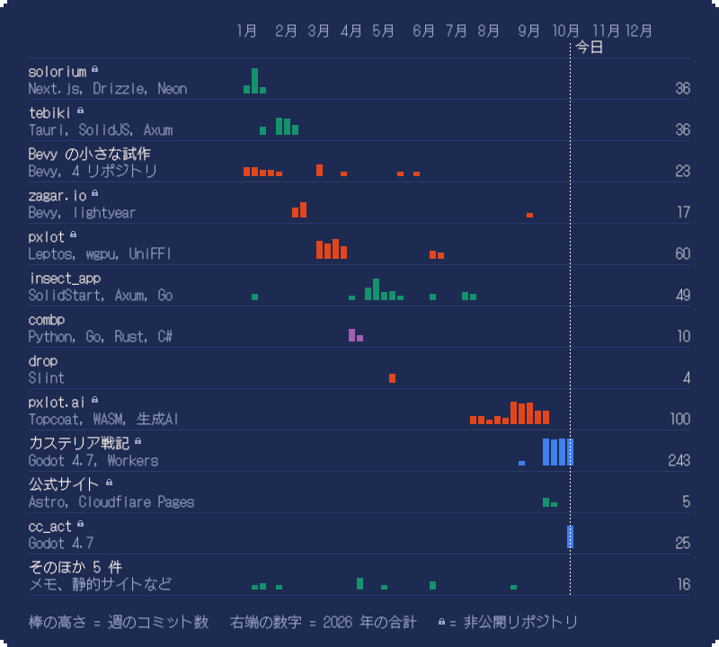
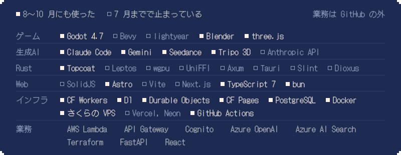
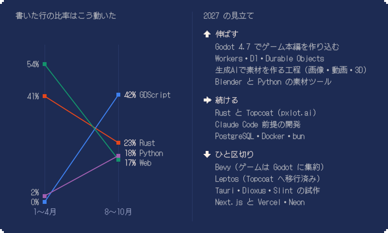

いま手を動かしているのは `godot/cc_act`。ドット絵エディタ [pxlot.ai](https://pxlot.ai) を公開中。2026.10.14 更新

### 作っていたもの

### 使った道具

### 2027 年へ

数字の出し方

 

- 対象は 2026/1/1〜10/14 にコミットのある 23 リポジトリ（うち非公開 16）。自分のコミットだけを数え、Copilot や bot のコミットは除いています。
- 書いた行は `git log --numstat` の追加行と削除行の合計です。ビルド成果物、ロックファイル、自動生成ファイル、JSON などのデータは数えていません。
- 「Web」は TypeScript, CSS, HTML, JavaScript, Astro をまとめたものです。

| 言語 | 変更行 | 比率 |
| --- | ---: | ---: |
| Rust | 336,043 | 31.2% |
| GDScript | 252,690 | 23.4% |
| TypeScript | 137,191 | 12.7% |
| Python | 116,021 | 10.8% |
| CSS | 90,640 | 8.4% |
| HTML | 66,702 | 6.2% |
| JavaScript | 64,023 | 5.9% |
| SQL | 7,548 | 0.7% |
| Go | 3,049 | 0.3% |
| Astro | 2,087 | 0.2% |
| C# | 1,000 | 0.1% |
| Kotlin, Swift, Shell, Dockerfile, WGSL, C | 1,552 | 0.1% |

図の文字は [DotGothic16](https://github.com/fontworks-fonts/DotGothic16)（SIL Open Font License 1.1）をアウトライン化して使っています。

