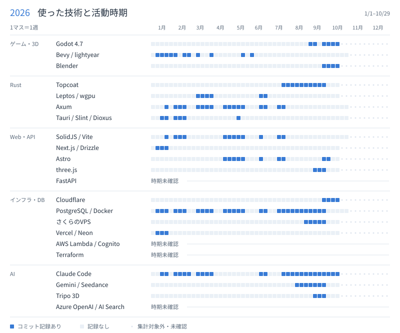

  <picture>
    <source media="(prefers-color-scheme: dark)" srcset="assets/2026/overview-dark.svg">
    
  </picture>

集計方法

- 1マス＝月曜始まりの1週。その技術を使うリポジトリに、本人のコミットがあった週を表示しています。技術そのものを変更した週とは限りません。
- 2026/10/14までの記録は元の図から引き継ぎ、以降は設定済みリポジトリのコミット履歴から毎日更新します。自動集計はコミット日時を日本時間で扱い、既定ブランチの本人によるコミットを対象にします。
- 更新元が未設定の技術は過去の記録を保持し、それ以降を「集計対象外・未確認」と表示します。Claude Codeの履歴だけで確認した技術は、期間がわかるまで「時期未確認」です。
- 非公開リポジトリからは技術別の週のみを反映します。[更新設定](docs/timeline.md) · [週別データ](data/2026-activity.json)

